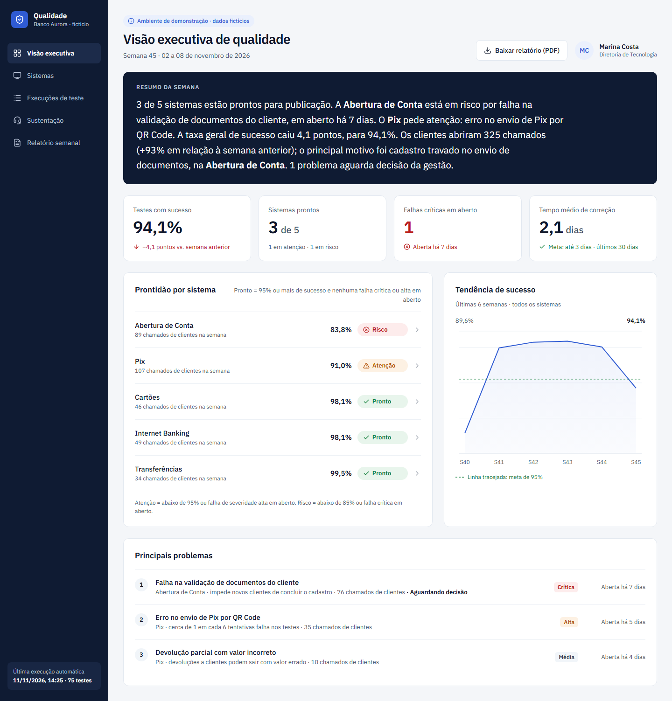
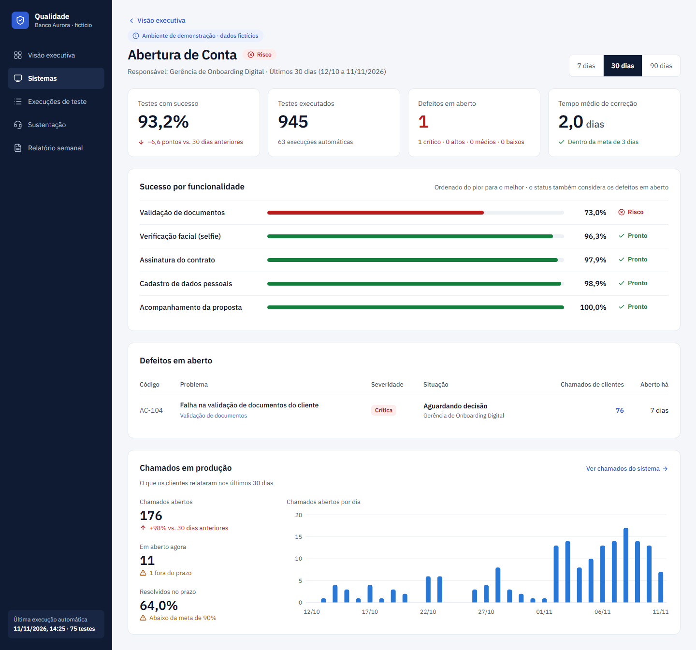
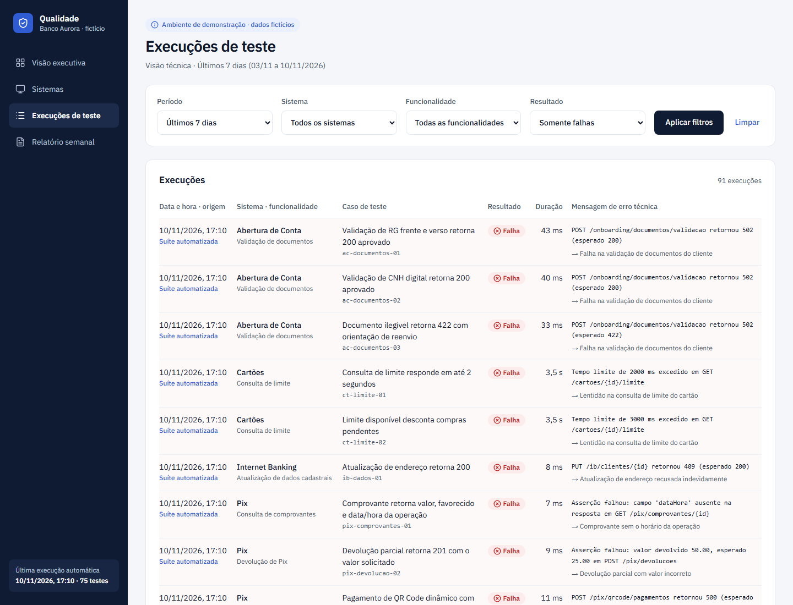
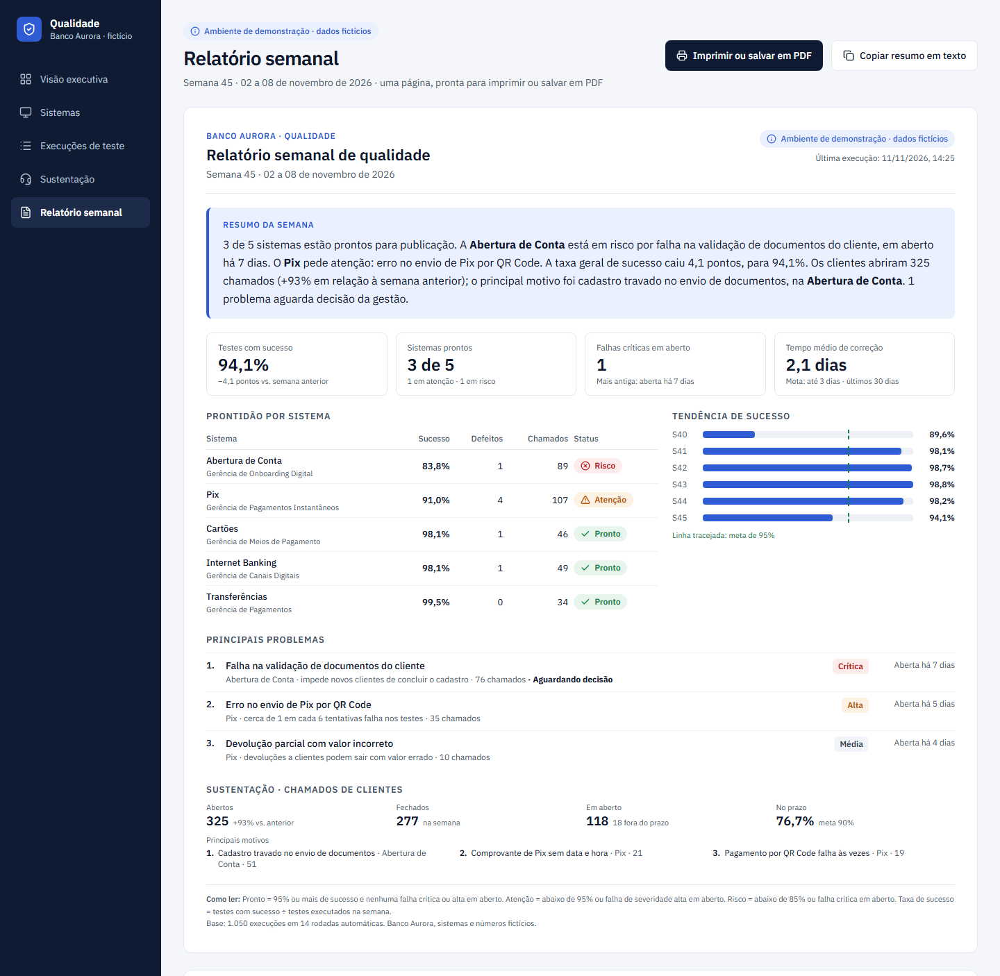
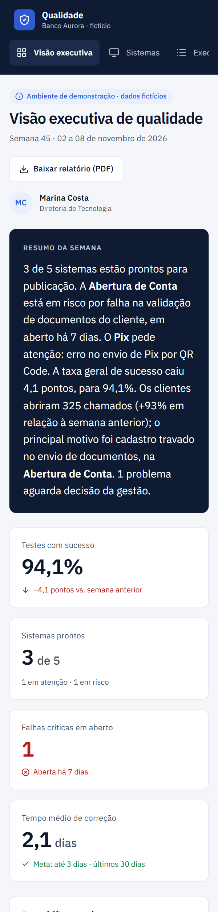
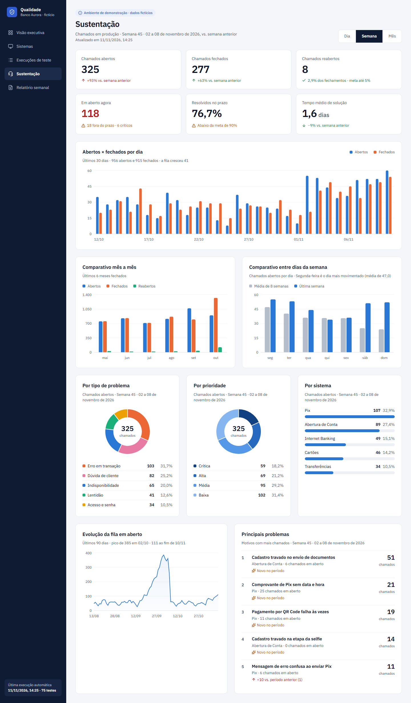
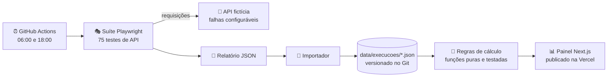

# Painel Executivo de Qualidade

[](https://github.com/leozinhoguima/painel-executivo-qualidade/actions/workflows/ci.yml)
[](https://github.com/leozinhoguima/painel-executivo-qualidade/actions/workflows/qualidade.yml)

**Automação que transforma resultados de testes de software em informação para gestores.**

🔗 **Demonstração ao vivo:** https://painel-executivo-qualidade.vercel.app

> **Ambiente de demonstração · dados fictícios.** O "Banco Aurora", seus sistemas, pessoas e números são inventados. O projeto não usa dados, nomes ou sistemas de nenhuma empresa real.



---

## O problema

Equipes de qualidade produzem milhares de resultados de testes por semana. Para quem decide, esses números não respondem às perguntas que importam:

- **O sistema está pronto para ir ao ar, ou tem risco?**
- **A qualidade está melhorando ou piorando?**
- **Onde estão os problemas, e que área de negócio eles afetam?**
- **Existe algo crítico parado que exige decisão?**

Um diretor não quer saber que "o teste `ac-documentos-01` retornou 502". Ele quer ler: *"A Abertura de Conta está em risco por falha na validação de documentos, em aberto há 6 dias, aguardando decisão."*

## A solução

Um painel em três níveis de detalhe, alimentado **automaticamente** por uma suíte de testes, que traduz resultados técnicos em linguagem de negócio. Cada tela responde às perguntas acima em segundos.

| Nível | Para quem | O que responde |
|---|---|---|
| **Visão executiva** | Diretoria | Resumo da semana em texto, semáforo de prontidão, tendência e os 3 principais problemas, com os chamados de clientes de cada um |
| **Visão do gerente** | Gerência do sistema | Sucesso por funcionalidade, defeitos em aberto e situação, nos últimos 7, 30 ou 90 dias |
| **Visão técnica** | Time de QA e desenvolvimento | Cada execução com a mensagem de erro original **e** a tradução de negócio |
| **Relatório semanal** | Quem repassa a informação | Uma folha A4 para imprimir ou salvar em PDF, mais o texto pronto para e-mail |
| **Sustentação** | Gestão de sustentação | Chamados em produção por dia, semana ou mês: abertos, fechados, reabertos, fila, prazo de atendimento, comparativos, principais problemas e a lista de cada chamado com o defeito que o causou |

<table>
  <tr>
    <td></td>
    <td></td>
  </tr>
  <tr>
    <td align="center"><b>Visão do gerente</b>: do defeito aos chamados de clientes</td>
    <td align="center"><b>Visão técnica</b>: erro original → linguagem de negócio</td>
  </tr>
  <tr>
    <td></td>
    <td></td>
  </tr>
  <tr>
    <td align="center"><b>Relatório semanal</b>: testes e chamados em uma folha, pronto para PDF</td>
    <td align="center"><b>Celular</b>: a visão do diretor funciona em qualquer tela</td>
  </tr>
</table>

**Sustentação:** os chamados em produção por dia, semana ou mês, com comparativos entre dias e entre meses, a divisão por tipo, prioridade e sistema, e os principais problemas. Os incidentes que os testes pegaram aparecem também aqui, como chamados de clientes.



---

## Como funciona a automação



1. **Execução:** duas vezes por dia, o GitHub Actions sobe uma API fictícia do Banco Aurora e roda 75 testes Playwright contra ela, um para cada caso de teste do catálogo. A API simula problemas reais (indisponibilidade, lentidão, campo ausente, valor incorreto), configuráveis em [`demo-api/cenarios.json`](demo-api/cenarios.json).
2. **Coleta:** o relatório JSON do Playwright é convertido para o modelo do painel, sem nenhuma cópia manual.
3. **Consolidação:** a nova rodada é gravada em `data/execucoes/` por um commit automático.
4. **Apresentação:** o commit dispara o deploy na Vercel, e o painel exibe os indicadores atualizados.

Para que o painel nunca fique vazio, há também um **histórico fictício de 13 semanas**, gerado com seed fixa **no mesmo formato** dos dados importados. Rodadas reais e histórico passam pelas mesmas regras: na primeira rodada real, as falhas caíram exatamente nos mesmos defeitos já abertos no histórico.

---

## Regras de negócio

Todos os indicadores são **calculados a partir dos registros**, nunca digitados à parte, por funções puras com testes unitários.

| Indicador | Regra |
|---|---|
| **Taxa de sucesso** | testes com sucesso ÷ testes executados no período |
| **Semáforo** | 🔴 **Risco**: abaixo de 85% ou falha crítica em aberto · 🟡 **Atenção**: abaixo de 95% ou falha de severidade alta em aberto · 🟢 **Pronto**: os demais |
| **Defeito** | aberto quando o mesmo problema de negócio falha 2 vezes com menos de 4 dias entre as falhas; resolvido após 4 dias sem falhas |
| **Tempo médio de correção** | média em dias corridos da abertura à resolução, nos últimos 30 dias (meta: até 3 dias) |
| **Resumo da semana** | texto gerado a partir dos indicadores da última semana fechada |
| **Chamados** | abertos, fechados e reabertos são eventos no período; "em aberto" = o último evento até a data é abertura ou reabertura |
| **Prazo de atendimento** | da abertura ao primeiro fechamento: crítica 4 h, alta 1 dia, média 3 dias, baixa 5 dias (meta: 90% no prazo) |
| **Taxa de reabertura** | reaberturas ÷ fechamentos do período (meta: até 5%) |
| **Chamado ↔ defeito** | mesma funcionalidade, aberto entre 1 dia antes da primeira falha e 1 dia depois da correção |

**Camada de tradução:** cada mensagem técnica passa por regras ([`data/traducoes.json`](data/traducoes.json)) que a convertem em linguagem de negócio.

```
POST /onboarding/documentos/validacao retornou 502 (esperado 200)
  → Falha na validação de documentos do cliente
```

---

## Arquitetura

```
data/                 catálogo, traduções, acompanhamento de defeitos, execuções e chamados (JSON)
demo-api/             API fictícia (node:http) com falhas configuráveis
tests/api/            suíte Playwright: um teste por caso do catálogo
scripts/              geradores do histórico e dos chamados, importador e fluxo completo (npm run qualidade)
src/
  dominio/            tipos, regras de cálculo (funções puras) e montagem de cada visão
  importacao/         conversão do relatório JSON do Playwright
  dados/              leitura e validação dos JSON (somente no servidor)
  componentes/        interface (React + Tailwind CSS)
  app/                rotas do Next.js (App Router)
.github/workflows/    rodada agendada de qualidade e CI
docs/decisoes.md      registro de decisões técnicas e de negócio, com o porquê
```

**Separação de responsabilidades:** a interface não calcula nada. Ela recebe números prontos de funções puras (`src/dominio`), que recebem dados já validados (`src/dados`). Isso permite testar todas as regras sem abrir o navegador e garante que cartões, gráficos, tabelas, resumo e relatório mostrem sempre os mesmos valores.

## Principais decisões

O registro completo, com alternativas e motivos, está em [**`docs/decisoes.md`**](docs/decisoes.md). Alguns destaques:

- **Defeitos derivados dos testes, não cadastrados à mão.** A abertura e a resolução vêm das execuções; um arquivo de acompanhamento só acrescenta situação ("aguardando decisão") e responsável.
- **Um defeito é um problema de negócio, não um teste.** Três testes falhando pelo mesmo motivo formam um único defeito.
- **Dados em JSON versionados no Git, sem banco de dados.** O histórico fica auditável e o fluxo "Actions faz commit → Vercel publica" é simples de explicar e de manter.
- **Playwright só para API**, sem navegador: rápido (cerca de 5 s) e leve no CI.
- **O número exibido e o status nunca se contradizem:** a classificação usa a taxa arredondada como aparece na tela.

## Qualidade

| Verificação | Ferramenta | Quantidade |
|---|---|---|
| Testes unitários das regras, do importador e da API | Vitest | 99 testes |
| Testes de API contra o sistema fictício | Playwright Test | 75 testes |
| Lint, checagem de tipos e build | ESLint, TypeScript estrito e Next.js | a cada push (CI) |

Os testes unitários incluem **testes de coerência**: a taxa da visão técnica é igual à do gerente, que bate com a contagem direta das execuções, que é a mesma do relatório.

**Acessibilidade:** status sempre com ícone e texto (nunca só cor), foco visível, áreas de toque de 44 px, gráfico com descrição textual e tabela equivalente, link "Pular para o conteúdo" e filtros que funcionam sem JavaScript.

---

## Como executar

Pré-requisito: [Node.js 24](https://nodejs.org/) (LTS).

```powershell
git clone https://github.com/leozinhoguima/painel-executivo-qualidade.git
cd painel-executivo-qualidade
npm install
npm run dev
```

Acesse http://localhost:3000.

### Rodar a automação localmente

```powershell
npm run qualidade
```

Esse comando sobe a API fictícia, roda os 75 testes, importa o resultado e grava uma nova rodada em `data/execucoes/`. Recarregue o painel para vê-la.

### Simular a correção de um problema

1. Em [`demo-api/cenarios.json`](demo-api/cenarios.json), mude `"ativa": true` para `false` no cenário desejado.
2. Rode `npm run qualidade` algumas vezes.
3. O teste volta a passar, e o defeito é resolvido sozinho depois de 4 dias sem falhas.

### Outros comandos

| Comando | O que faz |
|---|---|
| `npm test` | testes unitários (Vitest) |
| `npm run test:api` | só a suíte Playwright |
| `npm run api:demo` | só a API fictícia (porta 4010) |
| `npm run dados:historico` | regenera o histórico fictício (seed fixa) |
| `npm run dados:chamados` | regrava os chamados fictícios até a última rodada (ou até a data informada) |
| `npm run lint` / `npm run typecheck` / `npm run build` | verificações do CI |

## Stack

Next.js 16 (App Router) · React 19 · TypeScript 5.9 · Tailwind CSS 4 · Recharts 3 · Lucide React · Vitest 4 · Playwright Test 1.64 · GitHub Actions · Vercel

## Evoluções possíveis

- Integração com um sistema de chamados real (por exemplo, o Jira) no lugar do arquivo de acompanhamento e da central fictícia.
- Banco de dados quando o volume de execuções justificar.
- Envio automático do relatório semanal por e-mail.
- Metas de sucesso por sistema e alertas quando um sistema mudar de status.

---

> Projeto de portfólio. Todos os dados, sistemas e pessoas são fictícios.
